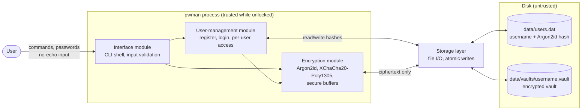

# Checkpoint 1: Architecture and Threat Model

**Project:** Secure Password Manager (`pwman`)
**Course:** ICS0022 Secure Programming
**Language:** C++17
**Libraries:** libsodium (cryptography, secure memory), nlohmann/json (vault serialization)

## 1. Architecture

**Modules**

- **Interface module:** interactive CLI. Reads input, validates it, reads passwords without echo, never prints passwords.
- **User-management module:** registers users, verifies the master password against the stored hash, holds the current session and checks that every record operation belongs to the logged-in user.
- **Encryption module:** derives the vault key from the master password, encrypts and decrypts the vault, keeps keys and decrypted data in locked, zeroed memory.
- **Storage layer:** reads and writes `users.dat` and vault files. Only ever sees hashes and ciphertext.

**Data flow**

1. Login: Interface reads username and password → User-management verifies the password against the hash from `users.dat`.
2. Unlock: on success, Encryption module derives the key from the password and the vault salt → Storage returns the vault file → Encryption decrypts it into secure memory.
3. Operation (add/get/update/delete): Interface → User-management (ownership check) → Encryption module updates the in-memory vault.
4. Save: Encryption module re-encrypts with a fresh nonce → Storage writes it atomically.
5. Logout/exit: key and decrypted vault are wiped from memory.

**Where keys and data live**

- Master password: never stored; only its Argon2id hash in `users.dat`.
- Vault key: derived at login, held only in process memory, wiped on logout.
- Credentials: encrypted on disk; decrypted only in process memory while unlocked.

**Trust boundaries:** user ↔ process (all input untrusted), process ↔ disk (disk contents untrusted, may be read or tampered with).

## 2. Vault format and cryptographic scheme

**Master password verification:** `crypto_pwhash_str` (Argon2id, libsodium `MODERATE` limits), stored in `users.dat` as `username:<argon2id hash string>`.

**Key derivation:** `crypto_pwhash` (Argon2id) with a separate random 16-byte salt stored in the vault header → 32-byte key.

**Encryption:** XChaCha20-Poly1305 AEAD (`crypto_aead_xchacha20poly1305_ietf`), new random 24-byte nonce on every save. The header is passed as associated data, so it is also authenticated.

**Vault file** `data/vaults/<username>.vault`:

| Field | Size |
|---|---|
| Magic `PMV1` | 4 B |
| Format version | 1 B |
| Argon2id opslimit, memlimit | 8 B + 8 B |
| KDF salt | 16 B |
| Nonce | 24 B |
| Ciphertext + tag | variable (+16 B) |

**Plaintext (before encryption):** JSON array of entries `{id, site, username, password, notes}`.

## 3. Threat model

### Master password

| Threat | Mitigation |
|---|---|
| Password stored in plaintext | Only Argon2id hash is stored |
| Offline brute force of the hash | Argon2id with a memory-hard cost and unique salt |
| Online guessing at login | Increasing delay after failed attempts, lockout after 5 failures per session |
| Weak master password | Minimum length of 12 characters at registration |
| Password shown on screen | Input read with terminal echo disabled |

### Vault at rest

| Threat | Mitigation |
|---|---|
| Vault file stolen | Encrypted with XChaCha20-Poly1305; key never stored |
| Vault file tampered with | AEAD tag and authenticated header; decryption fails on any change |
| Tampered KDF limits in header (resource exhaustion) | opslimit/memlimit range-checked before key derivation |
| Nonce reuse | New random nonce on every save |
| Corruption from interrupted write | Write to temporary file, then atomic rename |
| Other local users reading files | Data directory `0700`, files `0600`; separate vault per user, encrypted with that user's key |
| Path traversal via username in file name | Username restricted to `[A-Za-z0-9_]{3,32}` |

### Vault in memory

| Threat | Mitigation |
|---|---|
| Secrets left in memory after use | `sodium_memzero` / `sodium_free` on all key and password buffers |
| Secrets written to swap | Secure buffers allocated with `sodium_malloc` (locked pages) |
| Secrets in core dumps | Core dumps disabled at startup |
| Uncontrolled copies (e.g. `std::string`) | Secrets kept in an RAII `SecureBuffer` class, no plain strings |
| Buffer overflow | Bounds-checked containers, explicit length checks on all input |
| Unlocked vault left unattended | Auto-lock after 5 minutes of inactivity |

### Interface

| Threat | Mitigation |
|---|---|
| Password displayed in cleartext | Passwords never printed; `get` copies to clipboard, cleared after 20 s |
| Malformed or malicious input | Length limits and character whitelists on every field; reject control characters |
| Access to another user's records | Every record operation checked against the logged-in user |
| Information leakage in errors | Generic error messages to the user; details only in the log |
| Secrets in logs | Logs record event, user, timestamp and outcome only; no passwords or keys |
